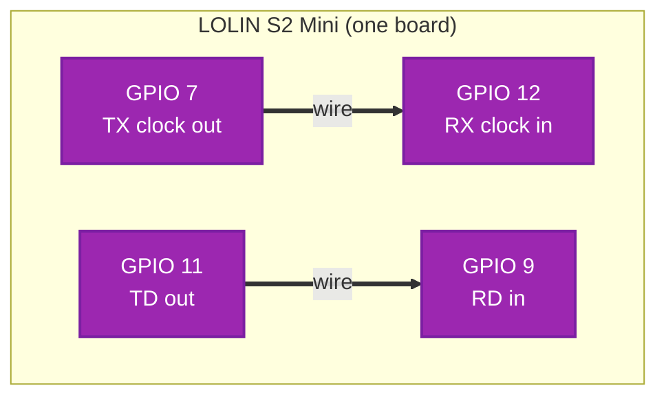
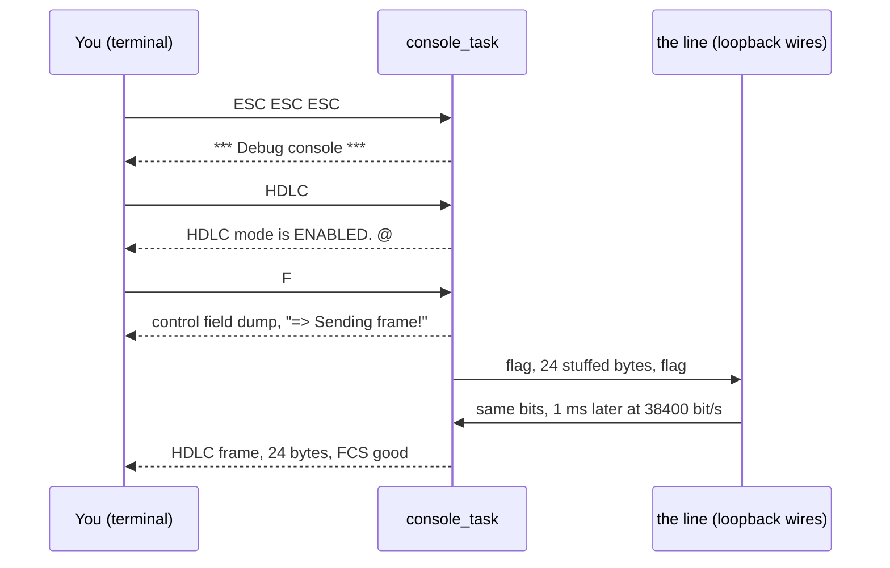
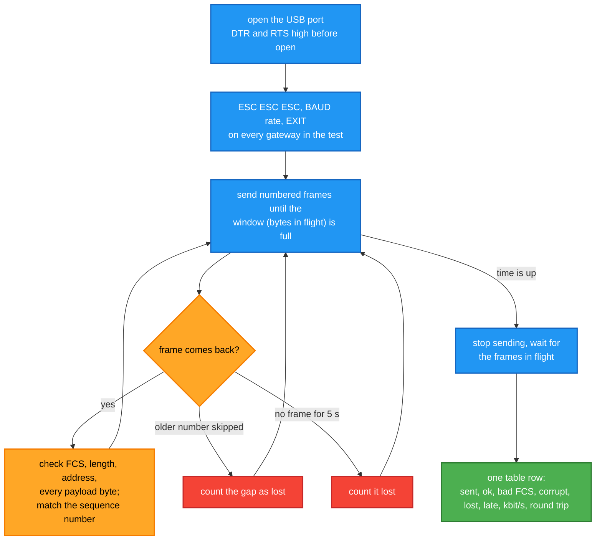
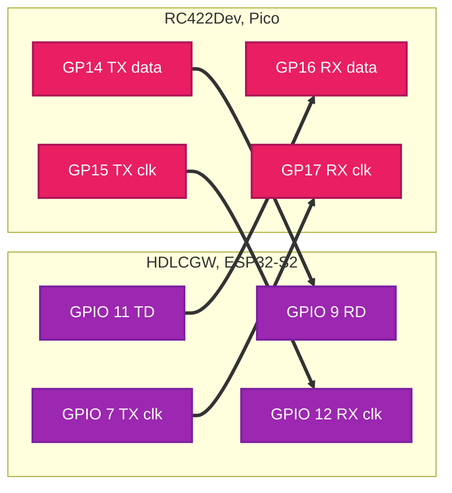

# Loopback test for the HDLC gateway

How to prove, on the bench, that this gateway sends and receives HDLC frames correctly: first
alone with two wires, then against a second gateway, then under full traffic for minutes at a
time. Every step says what to connect, what to type, what to expect and what a wrong answer
means.

## Contents

1. [What is being tested](#1-what-is-being-tested)
2. [Why a loopback](#2-why-a-loopback)
3. [Wiring](#3-wiring)
4. [Quick test from the console](#4-quick-test-from-the-console)
5. [Traffic test with hdlc-loopback](#5-traffic-test-with-hdlc-loopback)
6. [Two gateways: HDLCGW and RC422Dev](#6-two-gateways-hdlcgw-and-rc422dev)
7. [How to read the results](#7-how-to-read-the-results)
8. [Measured so far](#8-measured-so-far)
9. [When it does not work](#9-when-it-does-not-work)

## 1. What is being tested

The gateway sits between a PC and a synchronous HDLC line. Each direction of the line has its
own clock: the gateway generates the clock for what it sends, and follows the far end's clock
for what it receives.

```mermaid
flowchart LR
    HOST["PC: hdlc-loopback or any host program<br/>RFC 1662 byte-stuffed frames over USB"]
    CON["console_task<br/>USB serial, modes FORWARDING / DEBUG / PACKET_GEN"]
    ENC["hdlc encoder<br/>bit stuffing, flags"]
    TX["spi_tx_task<br/>SPI2 master, DMA<br/>clock out GPIO 7, data out GPIO 11"]
    RX["spi_rx_task<br/>SPI3 slave, DMA<br/>clock in GPIO 12, data in GPIO 9"]
    DEC["hdlc decoder<br/>flag hunt, un-stuffing, FCS"]
    USB["usb_tx_task<br/>frames back to the PC"]
    LINE(("the line<br/>two wires in loopback"))

    HOST -->|frame + FCS| CON --> ENC --> TX --> LINE
    LINE --> RX --> DEC --> USB -->|frame + FCS| HOST

    classDef app   fill:#2196F3,stroke:#1565C0,stroke-width:2px,color:#fff
    classDef core  fill:#009688,stroke:#00695C,stroke-width:2px,color:#fff
    classDef frame fill:#FFA726,stroke:#F57C00,stroke-width:2px,color:#000
    classDef media fill:#9C27B0,stroke:#7B1FA2,stroke-width:2px,color:#fff

    class HOST app
    class CON,TX,RX,USB core
    class ENC,DEC frame
    class LINE media
```



A frame goes all the way round: PC to USB, byte un-stuffing, bit stuffing, out on the SPI
master with its clock, back in on the SPI slave on that same clock, bit un-stuffing and FCS
check, byte stuffing, USB, PC. The FCS the PC computed travels with the frame the whole way
and is checked twice: by the decoder on the board and by the PC when the frame comes back.
Nothing in between adds or strips it, so a frame that returns intact proves every stage.

## 2. Why a loopback

- **It needs nothing but the board and two wires.** No second device, no line driver, no
  scope.
- **It exercises the real transmit and receive hardware**, not a software short-circuit. The
  bits go out on one GPIO and come back in on another, through the SPI peripherals and the
  DMA, exactly as they would to a far end.
- **The receiver gets a clock it did not make.** The receiver is an SPI slave; in loopback the
  transmitter's clock plays the far end's clock. That is the one thing a software test
  cannot do.
- **It finds timing problems that single frames hide.** The bench found two of them on
  2026-11-08: a transmit task that starved the console, and frames split by idle bytes when
  the ring buffer ran dry mid-frame. Both only showed with several frames in flight. A third
  one, phantom one-byte "frames" between back-to-back frames, only showed in the counters
  after thousands of frames.

What a loopback does **not** prove: that the far end agrees on clock polarity and bit order.
Section 6 covers that with a second gateway.

## 3. Wiring

The LOLIN S2 Mini prints GPIO numbers on its pads. All four pins are 3.3 V signals.

| From | To | Signal | Why |
|---|---|---|---|
| GPIO 7 | GPIO 12 | transmit clock out to receive clock in | the receiver follows this clock |
| GPIO 11 | GPIO 9 | transmit data out (TD) to receive data in (RD) | the bits themselves |



No ground wire is needed, it is one board. No chip select: an HDLC line is one endless bit
stream and the receiver's chip select is tied to a constant inside the chip.

These are **not** the chip's fixed SPI pins. The ESP32-S2 routes any SPI signal to any GPIO
through its GPIO matrix (datasheet v1.9, sections 2.3.1 and 2.3.6; the fixed IO MUX pins in
Table 2-3 are 12 = clock, 11 = data out, 13 = data in, 10 = chip select for SPI2, and SPI3 has
none). The "7 / 9 / 11 / 12 = SCK / MISO / MOSI / SS" set that Arduino tools print is only the
board file's default, so GPIO 12 is a receive clock input here, not a chip select.

## 4. Quick test from the console

Open the USB serial port at any speed (it is USB, the number does not matter) with the
Arduino IDE serial monitor or `arduino-cli monitor`. In the default FORWARDING mode the port
carries binary frames and prints nothing; press **ESC three times** to open the text console.

```
HDLC                 turn on HDLC frame decoding of what the line receives
F                    send the built-in 24-byte test frame (address 55, control 00, A..T + FCS)
```

Expected within a few milliseconds:

```
HDLC frame, 24 bytes, FCS good
```

Then try the rest of the command set, which is the same as RC422Dev's:

| Command | What it does | What to expect |
|---|---|---|
| `F 01 03 48 49` | frame with address 01, UI control 03, "HI"; FCS added; dumps the control field, then sends | `HDLC frame, 6 bytes, FCS good` |
| `INSPECT` | dump the last frame received from the line | the same bytes, `Received CRC=0x5862 [OK]` |
| `DECODE 01 3F` | decode a frame offline, nothing sent | `Msg name : SABM`, `Poll/Final : 1` |
| `BAUD 115200` | transmit clock to 115200 bit/s (9600..983000, any value) | `Baud rate set to 115200` |
| `STAT` | counters, see section 7 | SENT and RECEIVED OK counts equal |
| `TASK`, `INFO` | FreeRTOS tasks, build date, heap | |
| `CLOCK OFF` / `CLOCK ON` | stop or run the transmit clock (HDLCGW only); frames wait while it is off | `Transmit clock OFF: line quiet, ...` |
| `EXIT` | back to FORWARDING | |



## 5. Traffic test with hdlc-loopback

`hdlc-loopback` is a C# command-line tool in the `HdlcGatewayTest` repository
(RetroCoreLabs on GitHub). It speaks the same byte-stuffed protocol any host program would,
so it tests the gateway the way it will be used, not through the console.

What one run does, per clock rate:



Every frame carries its own sequence number, its length and a payload generated from the
number, so the receiver rebuilds what should have arrived from the header alone and compares
byte for byte. The window keeps a bounded number of bytes in flight, which is also what stops
the gateway's buffers from overflowing.

### Run it

```powershell
# find the port: the ESP32-S2 shows as "USB Serial Device", VID 303A
hdlc-loopback --list

# the default: six rates, two minutes each, 126-byte frames (fits RC422Dev too)
hdlc-loopback --port COM10

# maximum throughput on HDLCGW alone: 1024-byte frames, bigger window
hdlc-loopback --port COM10 --size 1024 --window 12000

# a quick look, ten seconds per rate
hdlc-loopback --port COM10 --rates 9600,38400,983000 --seconds 10
```

| Option | Default | Meaning |
|---|---|---|
| `--rates` | 9600,19200,38400,115200,307200,983000 | transmit clock rates, one run each |
| `--seconds` | 120 | traffic time per rate |
| `--size` | 126 | frame length including FCS; 10..1024 (RC422Dev takes at most 128) |
| `--window` | 3000 | encoded bytes in flight per direction |
| `--timeout` | 5 | seconds before an unseen frame is counted lost |
| `--no-baud` | | skip the console BAUD step |
| `--verbose N` | 0 | describe the first N bad frames: length against the header, first differing byte, hex dump |

While it runs, one status line per second shows frames sent, ok, bad and lost and the payload
rate. At the end a table has one row per rate and direction, and the exit code is 0 only when
every row is PASS.

The timeout is raised automatically when the window takes longer than that to cross the line
(12000 bytes at 9600 bit/s is 10 s); the tool prints the value it uses. `--verbose` is the
first thing to reach for when a row fails: "got 127 bytes, header says 126, first difference at
offset 1" found a firmware bug in one run that the counters alone could only have called "bad
FCS".

## 6. Two gateways: HDLCGW and RC422Dev

RC422Dev is the Raspberry Pi Pico version of this gateway. It speaks the same byte-stuffed
protocol on USB and the same console commands, so the same tool drives both at once: frames
go from A to B and from B to A at the same time, each direction checked on its own.

Wiring between the ESP32-S2 and the Pico, 3.3 V logic, no transceivers, both boards on USB:

| ESP32-S2 (HDLCGW) | Pico (RC422Dev) | Signal |
|---|---|---|
| GPIO 11 TD out | GP16 RX data in | ESP sends, Pico receives |
| GPIO 7 TX clock out | GP17 RX clock in | ESP's clock for those bits |
| GPIO 9 RD in | GP14 TX data out | Pico sends, ESP receives |
| GPIO 12 RX clock in | GP15 TX clock out | Pico's clock for those bits |
| GND | GND | common ground, required |

Take the two loopback wires off first. Leave the Pico's VBUS and the S2 Mini's VBUS pin alone,
those are 5 V.



Facts about the two ends that matter here (from both firmwares' source):

- Both are plain NRZ, LSB first, zero stuffed after five ones, flag 0x7E, CRC-16/X.25 FCS.
- HDLCGW's transmit clock runs all the time, idling the line at ones between frames. The
  Pico's transmit clock idles high and stops between frames. HDLCGW's receiver samples on the
  rising edge and is clocked only by edges, so a stopped clock is fine; the Pico's receiver is
  the same.
- The Pico's frame limit is 128 bytes including FCS, so use `--size 126` or less. HDLCGW takes
  1024.
- **A stopped clock leaves the tail of a frame in the ESP's SPI hardware.** Measured
  2026-11-08 with the `RXDMA` dump: the SPI DMA writes received data to memory in 4-byte words,
  holds the most recent complete word until one more byte arrives, and never writes a partial
  word. So when the far end stops its clock right after the closing flag, the last 4 to 7 wire
  bytes of that frame stay in the hardware until the next transmission pushes them out, and the
  frame arrives late or, if it was the last one, not at all. The receiver uses 4-byte DMA
  buffers and takes written words before the DMA announces them, which is as far as the ESP
  side can go. The rest is the transmitter's: a far end that stops its clock must send at least
  4 bytes of fill after every closing flag. Ronny's ruling 2026-11-08 for RC422Dev: the fill
  is ones (0xFF, line held at mark), not flags, and the clock may stop after it. A far end
  with a continuous clock, like HDLCGW itself, never has the problem.
- The Pico opens its console on ESC ESC ESC only before the first frame has been forwarded.
  Reset it between rates, or run one rate per invocation.

```powershell
hdlc-loopback --port COM10 --port-b COM8 --rates 19200 --size 126 --seconds 300
```

Before the traffic test, the console steps in section 4 work across the two boards as well:
`F 01 03 48 49` on one side should print as a good 6-byte frame on the other, and `F 01 3F`
(SABM, address 01) sent to the Pico makes it answer UA with info 00 67 on its own.

## 7. How to read the results

A rate **passes** when, for every direction: frames ok equals frames sent, and bad FCS,
corrupt, lost and decoder-dropped are all zero. Anything else is a FAIL, and which column is
non-zero says where to look:

| Column | Meaning | Where to look |
|---|---|---|
| BadFCS | a frame came back with bits changed | wiring, clock edge, a receiver sampling late |
| Corrupt | FCS good but length or payload wrong, or an address that is not ours | something rewrote the frame; or a second sender on the line |
| Lost | sent, never seen; a later frame skipped it, or 5 s passed | a buffer overflowed, or the frame was aborted on the line |
| Late | arrived after it was written off, or twice | a very slow path, or a duplicate |
| Dropped | the host-side byte-frame decoder threw a frame away | escape byte right before a flag, or a frame over the size limit |
| kbit/s | good payload bits per second over the whole run | the ceiling of the slowest stage, see section 8 |
| RTT | round trip per frame, mean and worst | grows with the window; a jump means a stall somewhere |

On the board, `STAT` in the console gives the other half of the picture:

```
HDLC frames   Total#   OK    BAD     BYTES
------------  ------ ------ ------ ----------
SENT            5747   5747      0    1377866
RECEIVED        5747   5747      0    1377866
Line RX: 1417637 bytes, 5525915 idle dropped, 0 FIFO overruns, 0 DMA errors, 0 ring overflow
USB TX: 0 frames dropped (host slower than line)
Line decoder: 1210 short flag-to-flag runs ignored
```

| Line | Meaning | Healthy |
|---|---|---|
| SENT / RECEIVED | frames the board put on the line / took off it | equal, BAD 0 |
| idle dropped | repeated 0xFF idle bytes not stored | large, grows while idle |
| FIFO overruns | the SPI slave's DMA FIFO filled, bits lost | 0 |
| DMA errors | descriptor errors | 0 |
| ring overflow | the receive ring filled before console_task drained it | 0 |
| USB TX dropped | frames to the PC thrown away because USB was slower than the line | 0 |
| short runs ignored | 1 to 3 bytes between two flags, which cannot be a frame | any number; one per back-to-back frame pair is normal |

The last line explains the "1339 BAD" that earlier firmware reported while every frame was
good: the transmitter pads the byte after a closing flag with idle ones, and when the next
frame follows at once, those ones plus the opening flag look like a one-byte frame. ISO 13239
calls a run shorter than 32 bits between flags invalid and says to ignore it; the decoder now
does. The first version of that fix had its own bug, the ignored byte stayed in the frame
collector and the next frame reached the PC one byte too long with a good FCS on the board
and a bad one at the host. `--verbose` showed it within one run; the decoder now tells the
collector to drop the bytes.

## 8. Measured so far

All on 2026-11-08, one LOLIN S2 Mini in loopback, ESP32 Arduino core 3.3.12, Windows host.

| Clock bit/s | Frame bytes | Window | Seconds | Sent | OK | Lost | Payload kbit/s | RTT mean/max ms |
|---|---|---|---|---|---|---|---|---|
| 9600 | 126 | 3000 | 8 | 92 | 92 | 0 | 9.1 | 1947 / 2222 |
| 38400 | 126 | 3000 | 8 | 308 | 308 | 0 | 36.3 | 528 / 567 |
| 983000 | 126 | 3000 | 8 | 1660 | 1660 | 0 | 207.1 | 93 / 146 |
| 983000 | 1024 | 12000 | 10 | 279 | 279 | 0 | 225.2 | 356 / 547 |
| 307200 | 1024 | 12000 | 10 | 334 | 334 | 0 | 266.0 | 299 / 367 |

Two things these numbers say:

- **At 9600 and 38400 the line is the bottleneck**, 95 percent of the clock rate comes through
  as payload, the rest is flags and stuffing. The round trip is simply the window divided by
  the line rate.
- **Above about 270 kbit/s the line is not the bottleneck.** With 12000 bytes in flight the
  round trip settles where bytes in flight divided by round trip is about 270 kbit/s, at 307200
  and at 983000 alike. The line at 983000 could carry three times that. The limit is in the
  path between the board and the PC: the Arduino core's USB CDC moves 64 bytes per USB
  transaction and waits for each. Which direction of USB limits has not been measured. This
  does not affect correctness, no frame was lost, but it caps what one gateway can forward to
  a PC.

### 8a. Long run: two minutes per rate, 1024-byte frames, 12000-byte window

| Clock bit/s | Seconds | Sent | OK | Lost | Payload kbit/s | RTT mean/max ms | Result |
|---|---|---|---|---|---|---|---|
| 38400 | 120 | 555 | 555 | 0 | 37.2 | 2178 / 2210 | PASS |
| 115200 | 120 | 1626 | 1626 | 0 | 110.3 | 737 / 753 | PASS |
| 307200 | 120 | 3942 | 3942 | 0 | 268.5 | 301 / 367 | PASS |
| 983000 | 120 | 3341 | 3341 | 0 | 227.7 | 355 / 534 | PASS |
| 9600 | 120 | 147 | 147 | 0 | 9.4 | 8483 / 8788 | PASS |
| 19200 | 120 | 283 | 283 | 0 | 18.7 | 4311 / 4394 | PASS |

The board's own counters after the last two rows: 5747 frames sent and 5747 received since
boot, 0 bad, 0 FIFO overruns, 0 ring overflow, 0 USB frames dropped, 1210 short flag-to-flag
runs ignored.

The first pass of 9600 and 19200 FAILED, and the fault was the test's, not the gateway's:
12000 bytes in flight take 10 s to cross a 9600 bit/s line, and the tool wrote every frame
off as lost after 5 s and then counted it late when it did arrive. The tool now raises the
timeout to three window times plus two seconds whenever the window is slower than the
timeout, and says so at the start of the rate (32 s at 9600, 17 s at 19200 here). The large
round trips in those two rows are that window: 12000 bytes queued ahead of each frame on a
slow line, not a delay in the gateway.

### 8b. Two gateways: HDLCGW and RC422Dev, first fair run

2026-11-08, wired as in section 6, 19200 bit/s, 126-byte frames, window 3000 bytes each way,
120 s, both directions at once. "Fair" because both transmitter bugs found during steps A to
C were fixed first: the Pico sent a 0x7E data byte as a bare flag, and the ESP's word-level DMA
handling handed a buffer back one lap late.

| Direction | Sent | OK | Bad FCS | Lost | Payload kbit/s | Result |
|---|---|---|---|---|---|---|
| Pico to ESP (B to A) | 1653 | 1650 | 0 at host, 3 on the line | 3 | 13.2 | FAIL by 3 frames |
| ESP to Pico (A to B) | 951 | 458 | 1 truncated | 493 | 3.7 | FAIL |

ESP counters agree: 1653 frames taken off the line, 1650 good, 3 bad FCS; 951 sent; no
overruns, no DMA errors, no USB drops. So Pico to ESP works at 99.8 percent, with 3 frames
whose cause is open (a stuffing corner case in the Pico, or a flipped bit). ESP to Pico loses
about half inside the Pico, and the rate falls as the run goes on (10 kbit/s in the first
seconds, 3 at the end); the Pico's own counters put the loss before its frame queue, in its
line receiver. That is the Pico firmware's open problem, not the wiring and not HDLCGW.

Earlier the same day, steps A to C by hand on the consoles: ESP frame decoded by the Pico (CRC
OK), Pico frame decoded by the ESP (CRC OK), SABM from the ESP answered by the Pico's automatic
UA and decoded by the ESP, all at 19200.

Later the same evening, with the Pico's receiver fixed (hunt register idles at ones, runs under
32 bits ignored, aborts handled) and the ESP's idle byte after each closing flag: bursts of 20
back-to-back 126-byte frames from the ESP arrived 60 of 60 at the Pico in FORWARDING mode,
three times over, and a control run with the ESP's old padding (no idle byte) also gave 60 of
60, so the Pico fix stands on its own and the idle byte is belt and braces. Pico frames into
the ESP with a TCP peer connected: all forwarded to TCP, and to USB as well with `MIRROR ON`,
checked on the raw bytes of both channels.

One rule of the Pico firmware cost a reset before every tool run that evening: RC422Dev opens
its text console on ESC ESC ESC only before the first frame it has forwarded. A tool that sends
any frame first, a HELLO for example, locks it out. Ronny's ruling: programs use the 0xFE
control frames, never the ESC console, and the Pico gets the same control frames as HDLCGW.

### 8c. Two gateways, control frames only, after the glitch filter

2026-11-08 late evening, same wiring as section 6, no ground wire added yet, 19200 bit/s,
126-byte frames, 60 s, both directions at once, driven from the Avalonia window through 0xFE
control frames on both boards (HDLCGW 0.2.0, RC422Dev 0.2.0). Change since 8b on the ESP: the
IO MUX glitch filter (25 ns) on the receive clock and data pins, `spi_rx_task.cpp`.

| Direction | Sent | OK | Bad FCS | Lost | Payload kbit/s | Result |
|---|---|---|---|---|---|---|
| Pico to ESP (B to A) | 838 | 838 | 0 | 0 | 13.8 | PASS |
| ESP to Pico (A to B) | 884 | 878 | 0 | 6 | 14.4 | FAIL by 6 frames |

Pico to ESP: the two runs before this one had 5 and 4 bad frames, every one a single bit read
as 0 instead of 1 with the length intact (`INSPECT BAD 0..3` showed them). With the filter on,
0 bad in 838, 0 FIFO overruns, 0 DMA errors, 0 ring overflow. A second 60 s run right after
gave 819 of 819, then three more of 838 of 838, so 4171 of 4171 since the filter went in. A
long run has still to say whether it stays at 0.

ESP to Pico: all 884 frames were decoded by the Pico (its own counters: 884 received, 884 OK,
0 dropped, 0 overflow, 0 abort) and its USB write call ran 894 times with no write refused for
"not connected", none longer than 293 us, no DTR change, no USB suspend; the PC saw 0 driver
errors, 0 bad frames, 0 decoder drops, and 878 frames. Six whole frames vanish between the
Pico's write call and the PC with no counter on either side. Whole frames, never a bad one at
the PC, means the loss is at frame granularity, inside the Pico's write path, not in a byte
FIFO. The second run (864 sent, 852 arrived, 12 lost) settled where: the PC's raw byte count
equals the stuffed size of the frames it decoded to the byte, so the PC lost nothing after the
bytes reached it, and the Pico handed more bytes to its USB stack than the PC received. The
12 frames go missing between the Pico's write call and the host's read path. A third run with
byte counters on the Pico's USB endpoint made it exact: 5 frames (stuffed sizes summing to
739 bytes) were handed to the Pico SDK's USB write, the call returned at once, and the
endpoint's started and completed byte counts both equal the PC's raw count to the byte, so
those frames never entered a USB transfer. The SDK's stdio write discards everything when
TinyUSB's "connected" flag is false, and that flag drops on a suspend event with no DTR
change. A fourth run with raw bus-event counters refuted that: 11 frames lost, no suspend,
reset or unplug during the run, "connected" true before and after every write. The drop is
between the SDK write accepting the bytes and TinyUSB starting a transfer, and all 11 came
from inside bursts. A fifth run with byte counters on TinyUSB's write and a per-write lag
detector found it: the 13 lost frames of that run never reached TinyUSB at all (bytes into its
FIFO = bytes started = bytes completed = the PC's count, to the byte), and the detector named
all 13 writes, each with the FIFO empty. The cause is in the Pico SDK, not in USB:
`mutex_try_enter_block_until()` in `pico_sync/mutex.c` returns false at once when the lock's
owner id equals the caller's, "deadlock", and `stdio_usb_out_chars()` then returns without
writing. Under FreeRTOS with `configSUPPORT_PICO_SYNC_INTEROP` off (the default when
`configNUMBER_OF_CORES` is 1) the owner id is the core number, so every task is "the same
caller": whenever the console task held the stdio mutex (its getchar poll, a control reply)
at the instant the receive task wrote a frame, the frame was dropped, fast, whole and
uncounted, about 1 in 100. The fix is to turn that option on so the lock owner is the task
and the second task waits instead of being refused. HDLCGW's side of all five runs is clean.

With that option on (RC422Dev build 23:47:05) the confirmation run passed both ways:

| Direction | Sent | OK | Bad FCS | Lost | Result |
|---|---|---|---|---|---|
| Pico to ESP (B to A) | 819 | 819 | 0 | 0 | PASS |
| ESP to Pico (A to B) | 864 | 864 | 0 | 0 | PASS |

Zero errors on every counter of all three parties: ESP line receiver (4990 of 4990 since the
glitch filter), Pico USB (lag events 0, longest write up from 330 us to 1278 us because a
write now waits for the console task's poll instead of being dropped), PC (0 driver errors,
0 overflow, 0 decoder drops). First clean two-board run in both directions, 2026-11-08 23:51.
A 5-minute run right after, same builds, 19200: ESP to Pico 4272 of 4272, Pico to ESP 4065
of 4065, every counter at zero on all three parties, the Pico's USB byte counts equal to the
byte at every stage. Note: until RC422Dev's next build the Pico's BAUD command only stored the
number and never changed its transmit clock, so every two-board run up to here was at 19200.

### 8d. Two gateways, full case sweep at four rates

2026-11-09 00:21 to 00:32, HDLCGW build 00:05:32, RC422Dev build 00:06:15 (Pico console
feed fix in), driven from the GUI session's window. At each rate: BAUD set on both boards by
control frame (all four rates accepted by both), STAT and HELP control frames, single frames
each way (plain, 7E/7D pairs, 60 bytes of FF, 00, 7E and 7D, a 128-byte frame of FF, the
4-byte minimum), a bad-FCS frame each way followed by a good one, bursts of 20 each way, then
both directions at once for 15 s at 10, 32, 64, 100 and 128 bytes and 60 s at 126 bytes.

Payload kbit/s and lost frames, both directions at once:

| Rate | Frame bytes | ESP to Pico | Lost | Pico to ESP | Lost |
|---|---|---|---|---|---|
| 19200 | 126, 60 s | 18.1 | 0 | 17.9 | 0 |
| 57600 | 126, 60 s | 48.6 | 0 | 47.5 | 0 |
| 307200 | 10, 15 s | 57.3 | 4110 of 15366 | 77.9 | 0 |
| 307200 | 32 / 128, 15 s | 104.1 / 112.7 | 1 / 1 | 103.2 / 111.5 | 0 |
| 307200 | 126, 60 s | 113.7 | 0 | 112.5 | 0 |
| 983000 | 10 .. 128, 15 s | 15.5 .. 59.1 | 461 .. 6606 | 42.0 .. 92.3 | 0 |
| 983000 | 126, 60 s | 55.9 | 1798 of 5378 | 84.9 | 0 |

- **19200 and 57600**: every case passed, no frame lost or bad anywhere.
- **Pico to ESP passed at every rate up to 983000**: the ESP's receiver, its rings and its
  USB path to the PC were clean in all 24 traffic runs (0 FIFO overruns, 0 DMA errors,
  0 ring overflow, 0 USB TX drops, 0 bad frames received).
- **ESP to Pico, where it breaks** (bytes the ESP clocked out, data plus idle, compared with
  the bytes the Pico's receiver counted, per run): equal within a few hundred bytes up to
  307200, which is the two STAT reads not being at the same instant. At 307200 with small
  frames the Pico's received-frame queue filled (11 of 12) and it dropped whole frames: its
  DROPPED count equals the 4110 lost. At 983000 the Pico received 2000 to 7300 fewer bytes
  than the ESP sent in every run, so its receiver itself loses bytes there. Both are in the
  Pico firmware.
- **Bad-FCS frames**: counted bad on the receiving board, not forwarded, the next good frame
  intact, at every rate. Four cases (single frame and bad FCS, Pico to ESP, at 307200 and
  983000) first failed because the test checker took an ESP event control frame for the data
  frame; with the checker fixed to ignore control frames they were run again at 00:36 and
  00:37 and all passed, each one recorded as PASS in the tool's log.
- The PC test tool writes both ports from one thread, and its writes to the Pico block for
  most of a run (15.3 s inside Write() in a 15 s run at 19200), so the PC-to-Pico pace also
  set the PC-to-ESP pace before the Pico's USB reading was fixed. Measured with per-port
  write counters.

### 8e. Two gateways at 983000, where the time goes (2026-11-09 night)

60 s runs, 126-byte frames, window 48000, ESP on COM10, Pico (RC422Dev) on COM18, driven by
the GUI tool. Measured with STAT and with TASK, which now shows each task's processor time.

| Build and change | Pico to PC alone | PC to Pico alone | Both ways, Pico to PC |
|---|---|---|---|
| 01:21 unbounded host read fixed | 90 kbit/s | 186 kbit/s | 31 kbit/s |
| 02:18 one ring lock per block, not per byte | 541 kbit/s | 224 kbit/s | 74 kbit/s |
| 02:55 USB input read straight from TinyUSB | 624.8 kbit/s | 318.7 kbit/s | 484.7 kbit/s |
| 04:16 line TX chunk about 2 ms of line time | 648.7 kbit/s | 373.8 kbit/s | 369.0 kbit/s |

- The first two-way runs delivered nothing from the Pico: the console read USB input "while
  bytes are available", the PC never paused, so the line drain never ran again. Fixed: at most
  256 host bytes per loop pass.
- TASK showed the single core with 1 to 7 percent idle. Every ring access took the ring mutex
  once per byte; one lock per block lifted Pico-to-PC sixfold with no ring overflow left.
- Every bad frame the Pico counted on PC-to-Pico came with field 39 (bytes the Arduino core
  dropped from USB input) rising, proven byte for byte on two frames. Since build 02:55:24
  the ESP reads USB input straight from TinyUSB (`usb_rx.cpp`), which makes the PC wait
  instead of losing bytes. Four 60 s runs at 983000 on that build, all PASS with 0 lost and 0
  bad: 626-byte frames ESP to Pico 4431 of 4431 at 364.2 kbit/s; two-way 126-byte frames
  9977 of 9977 (163.9 kbit/s) and 29500 of 29500 (484.7 kbit/s) at once; one-way 19291 of
  19291 and 37557 of 37557. Field 39 stayed 0, the Pico counted 0 bad and 0 dropped, the USB
  task fell from 36 to 43 percent of the CPU to 4 to 12, idle rose to 7 to 45 percent. The
  PC's write to the port blocks while the ESP is busy: that is the pacing, not a fault.

- One case still failed on 02:55: 10-byte frames both ways at 983000 (about 7000 frames a
  second) lost a few hundred frames a minute at the full USB TX ring. TASK showed the single
  core out of time; the line TX task alone took 12.6 percent handing the DMA a 64-byte chunk
  1900 times a second. With chunks of about 2 ms of line time it takes 5 percent and the
  10-byte runs lose nothing (343262 and 412608 frames in 60 s).
- Final sweep on that build (04:18-04:41): 376 PASS, 0 FAIL, all four rates, sizes 10 to 626,
  every case. In every ESP STAT delta: USB TX dropped 0, line RX overflow 0, RX bad 0, core
  USB drops 0. Pico BAD and DROPPED 0 in every run. Highest USB TX ring fill 2547 of 4096.

## 9. When it does not work

**The port is not there, or there is a new one with a different number.** The board may have
dropped into its ROM bootloader: it then shows as USB vendor 303A product 0002 instead of
80C2. The Arduino core does that on a particular DTR/RTS pattern from the host, and the .NET
serial port class produced it once. Upload the sketch again and it comes back. `hdlc-loopback`
sets DTR and RTS before it opens the port, which avoids the pattern.

**Nothing answers ESC ESC ESC.** The gateway's byte-frame decoder only looks for the escape
between frames; any stray byte, even a line feed, starts a "frame" and hides the ESCs. The
tool sends a flag first for that reason. By hand: send `~` (0x7E) then the three ESCs. If the
console was already open from an earlier session, just press Enter.

**Every frame is bad, or nothing is received, with a second gateway.** Check the clock edge:
HDLCGW's receiver is SPI mode 0, data sampled on the rising edge of the receive clock, and the
far end must set its data up while its clock is low. Check LSB first. Check the ground wire.

**Lost frames only at high rates and big frames.** Look at `STAT`: a non-zero "ring overflow"
means console_task was held up (a blocking USB write, before usb_tx_task existed); a non-zero
"USB TX dropped" means the PC is not taking frames as fast as the line delivers them, which is
the ceiling described in section 8, not a wiring fault. Smaller `--window` keeps the test
inside that ceiling.

**`BAUD` is refused.** Any value from 9600 to 983000 is accepted; it sets only this board's
transmit clock. The receiver has no rate setting at all, it follows the far end.
