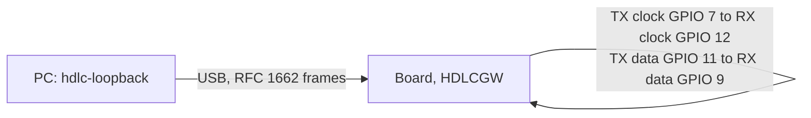
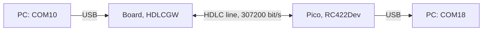
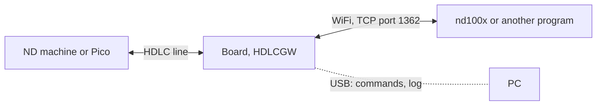
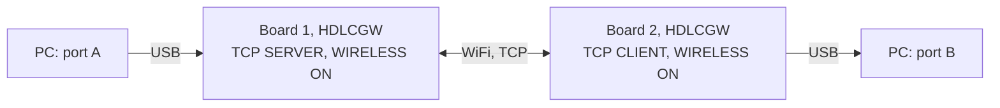
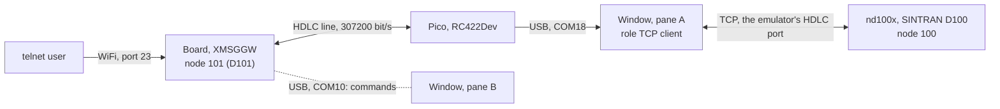

# Bench setups: HDLCGW, XMSGGW and the Pico

The ways the board has been wired and run on the bench, what each setup is for, how to start
it, and what was measured in it. Each result has its date; nothing here is a promise beyond
what was run.

The pieces:

| Piece | What it is |
|---|---|
| **The board** | LOLIN S2 Mini (ESP32-S2) with RS-422 drivers, on a DB-25 for the ND machine's HDLC socket. Holds two firmwares, one runs at a time ([Installing the firmware](INSTALL.md)) |
| **HDLCGW** | Firmware 1: passes line frames to a PC over USB, or over WiFi/TCP. The PC does the protocol work ([README](../src/HDLCGW/README.md)) |
| **XMSGGW** | Firmware 2: the board is an XMSG node by itself (node 101, D101 on the bench), with telnet and FTP ([README](../src/XMSGGW/README.md)) |
| **RC422Dev** | A Raspberry Pi Pico (RP2040) with the same line on its pins and USB to the PC. Used as the far end of the line instead of an ND machine |
| **The PC tools** | `hdlc-loopback` (command line) and `hdlc-gateway-tool` (the window, with an MCP server), from [HdlcGatewayTest](https://github.com/RetroCoreLabs/HdlcGatewayTest) |
| **The emulator** | nd100x running SINTRAN as D100 (node 100), with its HDLC port on TCP |

The line runs at **307200 bit/s** on the bench. Both ends must be set to the same rate (`BAUD
307200` on each). The board stores its rate; whether the Pico keeps its rate after a reset has
not been checked.

<!-- contents: written by src/tools/gen_toc.py, do not edit by hand -->
**Contents**

- [1. One board, line looped back](#1-one-board-line-looped-back)
- [2. Board and Pico, line to line, both on one PC](#2-board-and-pico-line-to-line-both-on-one-pc)
- [3. Board over WiFi to an emulator (TCP)](#3-board-over-wifi-to-an-emulator-tcp)
- [4. Two boards over WiFi, no cable](#4-two-boards-over-wifi-no-cable)
- [5. XMSGGW as node 101 talking to the D100 emulator through the Pico](#5-xmsggw-as-node-101-talking-to-the-d100-emulator-through-the-pico)
- [6. The Pico straight to the emulator (planned)](#6-the-pico-straight-to-the-emulator-planned)
- [Driving the boards from a program](#driving-the-boards-from-a-program)

<!-- /contents -->

## 1. One board, line looped back

The simplest check that a board works: its own transmit wired back to its own receive.



```powershell
hdlc-loopback --port COM10 --rates 38400 --seconds 10
```

Every frame sent must come back intact: `PASS` and exit code 0. The traffic test in the window
does the same with the path "Gateway A alone".

## 2. Board and Pico, line to line, both on one PC

The main bench setup. The board's line is wired to the Pico's line, and both are on USB to the
same PC (board COM10, Pico COM18). Frames go one way, the other way, or both at once, and both
ends count them.



```powershell
hdlc-loopback --port COM10 --port-b COM18 --rates 307200 --seconds 60 --size 626
```

In the window: pane A on COM10, pane B on COM18, Traffic test path "A to B and B to A" (or one
way only). Afterwards `STAT` on each board: the sent count on one end must match the received
count on the other.

**Measured:**

- 2026-11-09, at 983000 bit/s, 60 s per run: a sweep of every rate from 19200 to 983000 and frame
  sizes 10 to 626 bytes over USB, 376 of 376 runs passed. Figures in the
  [HDLCGW README](../src/HDLCGW/README.md#status).
- 2026-11-16, at 307200, both ways at once, 20 s each, after the move to frames of up to 4105
  bytes:

  | Frame size | Board to Pico | Pico to board | Bad or lost |
  |---|---|---|---|
  | 1024 bytes | 587 frames | 588 frames | 0 |
  | 1025 bytes | 580 | 695 | 0 |
  | 2048 bytes | 287 | 348 | 0 |
  | 4103 bytes | 144 | 165 | 0 |
  | 4105 bytes | 145 | 165 | 0 |

  A 4106-byte frame is refused by the Pico (counted as bad and as "over 4105"). The board
  passes a frame from USB of up to 4112 bytes and drops anything longer.
- 2026-11-16, 16-byte frames at 983000 for 60 s both ways: 211,122 and 56,166 frames, 0 bad.
- 2026-11-16, Pico to board only, 626-byte frames, 60 s at 307200: 3156 sent, 3156 good, 0 bad,
  0 lost. This was the check for an old fault where the board saw an extra bad frame; it did not
  come back.

The 4103-byte run first lost frames on the way to the PC: the board's USB send buffer (4 KB)
was smaller than one escaped frame. Since 2026-11-16 that buffer and the TCP one are 16 KB.

**The same wiring for RetroX25.** The RetroX25 test suite has eight serial tests and an X.25
trunk call test that need exactly this setup: board on COM10, Pico on COM18, line at 307200,
both ports free (close them in the window first). On 2026-11-18 all eight passed, and the trunk
call test passed 5 of 5 after a fix in RetroX25's own LAPB code.

## 3. Board over WiFi to an emulator (TCP)

HDLCGW hands the line to a program across the network instead of over USB. The TCP stream
carries the same RFC 1662 frames as USB; commands and the log stay on USB.



On the board (USB console or a COMMAND frame):

```
WIFI SETUP          (or WIFI SSID, WIFI PASS, WIFI ON)
TCP SERVER          (port 1362, found as hdlcgw.local)
```

The other program connects to `hdlcgw.local:1362`. `TCP CLIENT <host> <port>` makes the board
dial out instead. `MIRROR ON` also copies line frames to USB, to watch them.

**Measured** 2026-11-09 (HDLCGW README): at 983000, 626-byte frames both ways over TCP,
873.9 + 301.0 kbit/s, nothing lost. At 307200 every 626-byte case was clean; 10-byte frames both
ways (about 7000 a second) lost 0.4 % as whole frames when the processor ran out.

## 4. Two boards over WiFi, no cable

`WIRELESS ON` makes the TCP peer take the line's place: frames from USB go to the peer, and the
peer's frames come out on USB. Two boards, one `TCP SERVER` and one `TCP CLIENT` to it, then
behave like two boards with a cable between them.



**Known fault:** on the S2 Mini boards with a version 1.0 chip (`INFO` shows `rev 100`), USB data
from the PC fails within seconds while the board's WiFi is sending. `WIRELESS ON` is refused on
such a board unless `FORCE` is added. See
[Boards with a v1.0 chip](../src/HDLCGW/README.md#boards-with-a-v10-chip) and
[BUGS.md](../src/HDLCGW/BUGS.md) B1.

## 5. XMSGGW as node 101 talking to the D100 emulator through the Pico

The board runs XMSGGW and is an XMSG node by itself. The emulator has no real line, so the Pico
stands in as the emulator's line end, and the window forwards the Pico's frames to the emulator
over TCP.



Start it:

1. Board: `FIRMWARE SWITCH` into XMSGGW, `NODE 101`, `RESET`. Line rate `BAUD 307200` on both
   the board and the Pico.
2. Window, pane A: open COM18 (the Pico), Setup, role **TCP client** to the emulator's host and
   HDLC port (10362 on the bench). Pane A then lists every frame both ways.
3. Window, pane B: open COM10 (the board) for `STAT`, `INFO`, `WIFI STATUS`.
4. `STAT` on the board should say the LAPB link is up, peer 100.

**Measured** 2026-11-09 and 2026-11-10 (XMSGGW README):

- the LAPB link comes up with 0 bad frames;
- telnet to the board, `CONNECT D100`, a SINTRAN login and `LOGOUT`; 8 telnet users at once, a 9th
  refused;
- from D100's own terminal, `CONNECT-TO D101` reaches the board's login and prompt, and
  `LI-SYS D101` shows the real count of sessions in use;
- `NAMES`, `LIST`, `WHO`, `INFO`, and FTP to the board's files (since 2026-11-11).

Long output from SINTRAN is not limited by the line: one `HELP` listing took 5.8 s through
XMSGGW at 307200, 4.4 s at 900000, and 7.0 s between two emulators with no gateway at all.
SINTRAN sends two 255-byte frames and then waits 200-500 ms.

## 6. The Pico straight to the emulator (planned)

RC422Dev against the ND-100 emulator: a window pane on the Pico in the TCP server role, nd100x
dialling it, SINTRAN running. Not run yet; nothing is measured.

## Driving the boards from a program

None of these setups needs the text console. The tools talk to the firmware in control frames
on the same USB port that carries the line frames:

```powershell
hdlc-loopback --port COM10 --no-console --command "STAT" --command "BAUD"
```

The window does the same with its command box, and its MCP server lets an AI client do it with
the `hdlc_*` tools. One port has one owner: close a pane before another program opens that COM
port.
