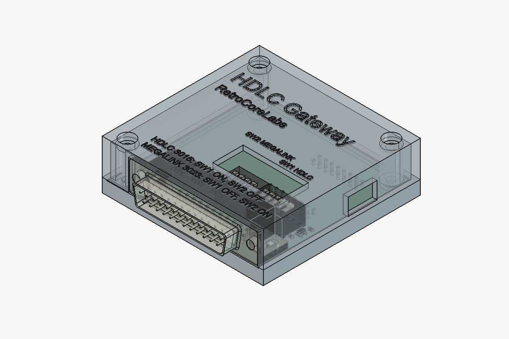

# HDLCGateway enclosure - files

3D-printed enclosure (base + lid) for the HDLCGateway carrier board
(KiCad project `F:\KiCad\ND\HDLCGateway\HDLCGateway-2026\`, board 61.84 x 61.84 mm,
ordered from JLCPCB 2026-11-25). Built in FreeCAD 1.1.3. Version 1, 2026-11-25.

## Files

| File | What it is | Use it for |
|---|---|---|
| `HDLCGateway_Enclosure.FCStd` | The FreeCAD model. Parametric: every dimension is a cell in the `Params` spreadsheet. Contains `Base`, `Lid`, the imported board (`HDLCGateway-board.step`) and `Board_print_dummy` (hidden). | Changing the design: edit a cell in `Params`, press Recompute (Ctrl+R), then export again. |
| `HDLCGateway_Enclosure.FCMacro` | FreeCAD macro that builds the whole model from nothing, with the same parameters and defaults as the FCStd. | Rebuilding from scratch (Macro → Macros… → Execute). Creates a new document and overwrites the FCStd and the STLs in this folder. |
| `Base.stl` | Bottom part: floor, side walls up to the PCB top, 3 standoffs with M3 heat-set insert holes, 2 support rings under the DB-25 board-lock holes. Watertight mesh. | Printing. |
| `Lid.stl` | Top part: lid plate, walls down to the PCB top, 3 screw bosses that clamp the PCB, DB-25 flange window, DIP-switch window, USB-C opening, engraved text. Watertight mesh. | Printing. |
| `Base.step`, `Lid.step` | The same two parts as exact CAD solids. | Importing into other CAD programs or a slicer that reads STEP (Bambu Studio does). |
| `HDLCGateway-board.step` | The real board as KiCad exports it (KiCad stock 3D models), in the enclosure's coordinates. DB-25 pins trimmed to 1 mm under the board. No ESP32 module (it has no 3D model in KiCad). | Checking the fit in CAD. Not for printing. |
| `HDLCGateway-board-dummy.stl` | Printable stand-in for the assembled board: PCB 1.6 mm with the 3 mounting holes, all parts on top, nothing below the underside (flat bottom), plus a block model of the WEMOS S3 mini on its headers with the USB-C receptacle. One solid. | Printing a test board and trying it in the printed enclosure before the real boards arrive. |
| `HDLCGateway-board-dummy.step` | The same dummy as a CAD solid. | Same, or for other CAD. |
| `HDLCGateway_Print.3mf` | Bambu Studio project (P1S, 0.4 mm nozzle), ready to slice. Plate 1: the board dummy, flat side down, supports on for this object only. Plate 2: `Base` floor down and `Lid` flipped (lid plate on the bed), no supports. | Printing: open in Bambu Studio, pick the process preset, slice each plate. |
| `enclosure-isometric.png`, `enclosure-front.png` | Views from FreeCAD: enclosure (lid transparent) with the board inside; front view on the DB-25. | Looking. |
| `board-dummy-isometric.png` | View of the print dummy. | Looking. |
| `HDLCGateway_Enclosure.*.FCBak` | FreeCAD's automatic backup of the previous save. Not in git. | Can be deleted. |

## Size and coordinates

- Outside: 66.64 x 65.07 x 20.35 mm (W x D x H).
- Frame (all files): X = board X, left edge 0, right edge (USB-C side) 61.84. Y = 0 at the DB-25
  (front) edge of the PCB, +Y toward the back; the DB-25 points to -Y. Z = 0 at the PCB underside,
  PCB top at Z = 1.6. Base from Z -4.0 to 1.6, Lid from 1.6 to 16.35.
- The DB-25 flange front face is the front face of the box (Y = -0.83), so the plug goes fully
  into the ND socket or a cable.

## Hardware

| Qty | Part | Where |
|---|---|---|
| 3 | M3 x 16 screw, pan or cylinder head (head up to 6 mm, sits in a 6.2 mm counterbore) | Through the lid bosses and the PCB holes H1-H3 into the base |
| 3 | M3 heat-set insert, **short type, length 3 mm or less**, for a 4.0 mm hole | In the base standoffs (hole 3.4 mm deep; 0.6 mm floor left under it) |
| 0-2 | M3 screw from below | Only if the real XUNPU DB-25 has threaded board-lock brackets: through the floor holes under the two support rings |

## Printing

- Material: PETG or ASA (sits next to a warm machine). No metal- or carbon-filled filament
  (WiFi antenna).
- `Base.stl`: as exported, floor on the bed.
- `Lid.stl`: flip it upside down, lid plate on the bed. The text is engraved 0.5 mm into the top.
- `HDLCGateway-board-dummy.stl`: flat underside on the bed. The DB-25 shell and the module block
  overhang: use supports for those.
- Walls, floor and lid plate are 2.0 mm.

### Bambu Studio project `HDLCGateway_Print.3mf`

The orientations above are already set in this project:

| Plate | Objects | Supports |
|---|---|---|
| 1 | `HDLCGateway-board-dummy.stl`, flat side down | On (object setting; tree, auto) |
| 2 | `Base.stl` floor down, `Lid.stl` flipped | Off (global setting) |

Why the lid is flipped (overhang check on the STL, 2026-11-25): top-up it has about 3500 mm²
of overhang (the whole roof) that needs support; flipped it has 268 mm², all short flat
bridges: the bottom of the engraved letters (0.5 mm up), the steps in the 3 screw-head
counterbores (3 mm up) and the top edge of the USB-C opening (12 mm wide). The base floor-down
has no overhang at all. Supports are off on plate 2 so the slicer does not fill the letters and
counterbores with support material.

Before slicing:

- Process preset in the project is `0.08mm Extra Fine @BBL X1C` (an X1C preset, very slow).
  For a fit test choose a P1S 0.20 mm preset: width and length come out the same, about half
  the print time; heights round to 0.2 mm steps (the 0.5 mm text depth becomes 0.4 or 0.6 mm).
  0.12 or 0.16 mm for a nicer final print.
- Filament in the project is Generic PLA. Fine for the test fit; for the real enclosure use
  PETG or ASA (see Material above) and select that filament preset.
- Not sliced yet; print time and filament use not known yet.

## Assembly

1. Press the 3 inserts into the base standoffs with a soldering iron.
2. Trim the through-hole pins under the PCB to about 1 mm.
3. Drop the PCB into the base, DB-25 to the front.
4. Put the lid on: its front edge goes over the top of the DB-25 flange.
5. 3 x M3 x 16 through the lid into the inserts.

## Not verified yet - measure the real parts, then edit `Params`

| Cell | Value now | Comes from |
|---|---|---|
| `flange_top` | 12.45 mm above the PCB top | KiCad stock DB-25 model, not the XUNPU drawing. Sets the lid height. |
| `usb_zc` | 6.7 mm | Estimate: PCB 1.6 + header spacer 2.5 + module PCB 1.0 + half USB-C 1.6. |
| `usb_w`, `usb_h` | 12 x 7 mm | Typical USB-C cable plug overmould. Check your cable. |
| `under` | 2.0 mm | Pins trimmed to about 1 mm plus 1 mm. Trim longer pins or raise this. |
| Module block (dummy only) | 34.3 x 25.4 x 1.0 mm board, 2.5 mm spacer, USB-C 8.94 x 7.35 x 3.16 mm | WEMOS S3 mini nominal size and a standard USB-C receptacle; not measured. |
| DIP switch height (board STEP and dummy) | 8.6 mm above the PCB | KiCad stock look-alike model, not the YE DSIC switch. The real switch is probably lower; the lid window only needs to give access. |

Checked in FreeCAD (2026-11-25): Base and Lid each one valid solid; no overlap with the board
STEP or the print dummy; STLs watertight (no open or non-manifold edges).

## Not in version 1

- No locating lip between lid and base (the 3 screws align them).
- No holes for the module's BOOT/RESET buttons or LED (positions not measured).
- The requirements behind this design: `F:\KiCad\ND\HDLCGateway\HDLCGateway-2026\Enclosure-Spec.md`.
